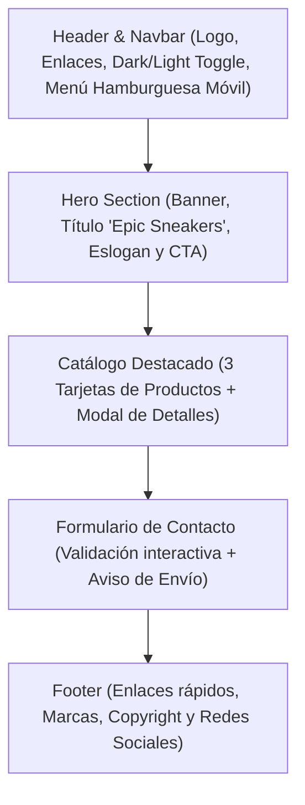

# Arquitectura del Sistema — Epic Sneakers

## 1. Visión General
**Epic Sneakers** es una aplicación web de página única (SPA autónoma en un único archivo `index.html`) orientada a la presentación de identidad de marca, catálogo destacado y canal de contacto directo para una tienda especializada en calzado deportivo.

## 2. Diagrama de Estructura de Secciones (Wireframe Vertical)

## 3. Especificación de Componentes de la Interfaz

### 3.1. Barra de Navegación (Header / Navbar)
- **Desktop:** Disposición horizontal `flex`, enlaces ancla a secciones (`#inicio`, `#catalogo`, `#contacto`), selector de modo claro/oscuro con íconos sol/luna y botón de acción rápida.
- **Móvil:** Botón menú hamburguesa que despliega los enlaces verticalmente de forma suave.
- **Sticky / Fixed:** Fijado en la parte superior con efecto de desenfoque de fondo (`backdrop-blur`).

### 3.2. Sección Portada (Hero Section)
- Título principal con tipografía **Roboto** en negrita y acento en gradiente cian.
- Eslogan deportivo motivacional.
- Botones de llamada a la acción (CTA): "Explorar Catálogo" (gradiente cian) y "Promociones" (gradiente rojo).

### 3.3. Sección Catálogo (3 Tarjetas)
- Grid responsive: 3 columnas en desktop (`grid-cols-3`), 1 columna en móvil (`grid-cols-1`).
- Componentes por tarjeta:
  - Imagen del producto con `alt` descriptivo.
  - Etiqueta de categoría/promoción con gradiente.
  - Nombre del modelo.
  - Breve descripción de muestra.
  - Precio formateado destacado.
  - Botón "Ver Detalles" con cursor pointer y hover.
- **Ventana Emergente (Modal):** Modal accesible con overlay oscuro, detalles técnicos, selector de talles, precio y botón para cerrar.

### 3.4. Formulario de Contacto
- **Desktop:** Nombre y Correo Electrónico distribuidos en 2 columnas paralelas (`grid-cols-2`), área de texto para Mensaje y botón "Enviar Mensaje" en fila inferior completa.
- **Móvil:** Formato en 1 sola columna vertical continua.
- **Feedback Interactivo:**
  - Cartel de advertencia/error si existen campos vacíos.
  - Cartel de éxito: *"Los datos han sido enviados correctamente"*.

### 3.5. Pie de Página (Footer)
- Información de la tienda, lista de marcas asociadas, enlaces de navegación y derechos reservados.
