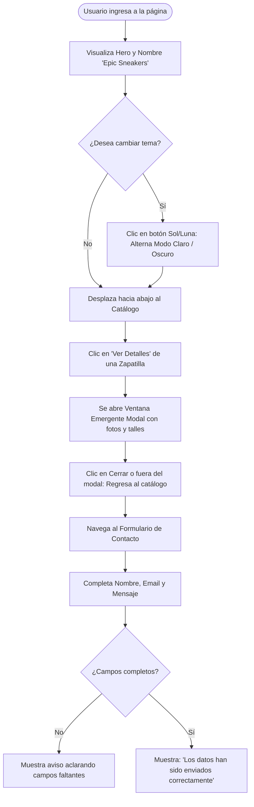

# Flujos de Usuario y de Trabajo — Epic Sneakers

## 1. Flujos Principales de Usuario

## 2. Ruta de Construcción Técnica (3 Fases)
1. **Fase 1: Estructura HTML5 Semántica**
   - Esqueleto general del documento con meta tags para responsive design y viewport.
   - Enlace a fuente Roboto en Google Fonts y script CDN de TailwindCSS con configuración de temas.
   - Marcado de contenedores principales: `<header>`, `<nav>`, `<main>`, `<section id="inicio">`, `<section id="catalogo">`, `<section id="contacto">`, `<footer>`.
2. **Fase 2: Maquetado y Estilos con TailwindCSS**
   - Implementación de clases de modo oscuro (`dark:...`) y modo claro.
   - Gradientes cian y rojo en botones, títulos e insignias.
   - Grid responsive para 3 tarjetas en escritorio y 1 en móviles.
   - Distribución del formulario (2 columnas en desktop, 1 en móvil).
   - Estilizado de micro-interacciones (hover, cursor pointer y transiciones).
3. **Fase 3: Interactividad y Validaciones en JavaScript**
   - Lógica de apertura y cierre del modal emergente con datos dinámicos.
   - Menú móvil responsive (toggle hamburguesa).
   - Alternador de modo oscuro/claro con guardado en `localStorage`.
   - Validación del formulario de contacto y avisos visuales de éxito o error.

## 3. Checklist de Control de Calidad (Definition of Done)
- [x] Visualización correcta en computadoras de escritorio (pantallas anchas).
- [x] Verificación en emulador de dispositivos móviles (F12 Responsive Mode: 375px, 414px, etc.).
- [x] Ausencia total de scroll horizontal involuntario en móviles (`overflow-x-hidden`).
- [x] Menú hamburguesa funcional (abre y cierra suavemente).
- [x] Modo oscuro activado por defecto y conmutación a modo claro funcional.
- [x] Tarjetas con efectos hover y cursor pointer activos.
- [x] Modal emergente abre y cierra correctamente sin trabas.
- [x] Formulario valida campos obligatorios y muestra el mensaje exacto de éxito.
- [x] Consola del navegador libre de errores en color rojo.
