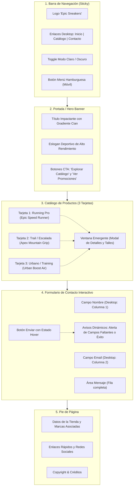

# Master Context — Epic Sneakers

> **Documento Maestro de Arquitectura y Especificaciones de Desarrollo**  
> **Proyecto:** Epic Sneakers (Tienda Web de Calzado Deportivo)  
> **Estado:** Aprobado y Consolidado (`trigger: always_on`)  
> **Formato de Entrega:** SPA Autónoma en un único archivo [`index.html`](file:///c:/itec/prog2/antigravity/antigravity_proyecto/index.html)

---

## 1. Resumen Ejecutivo e Identidad

* **Nombre de la Marca:** **Epic Sneakers**
* **Nicho:** Calzado deportivo de alta gama (running, trail/escalada, urbano y entrenamiento).
* **Propósito del Sitio Web:** Presentar la identidad de la tienda, exhibir un catálogo curado de 3 zapatillas destacadas con modal de especificaciones, promociones dinámicas y un canal de contacto directo y accesible para clientes.
* **Público Objetivo:** Corredores, deportistas de aventura y entusiastas del calzado deportivo.

---

## 2. Stack Tecnológico & Restricciones Estrictas

| Dimensión | Tecnología Seleccionada | Justificación Técnica |
| :--- | :--- | :--- |
| **Marcado Base** | **HTML5 Semántico** | Estructura nativa accesible (`<header>`, `<nav>`, `<main>`, `<section>`, `<article>`, `<button>`, `<footer>`). |
| **Framework CSS** | **TailwindCSS v3 (CDN)** | Maquetado rápido mediante clases de utilidad declarativas, sin requerir compilación local ni dependencias de Node.js. |
| **Interactividad** | **JavaScript Vanilla Moderno (ES6+)** | Manipulación directa del DOM, gestión de modales, menú hamburguesa, selector de tema y validaciones sin librerías pesadas. |
| **Tipografía** | **Google Fonts — Roboto** | Pesos 400 (Regular), 500 (Medium), 700 (Bold) y 900 (Black). |
| **Iconografía** | **SVG Inline Nativos** | Íconos vectoriales integrados (sol, luna, menú hamburguesa, cerrar modal, flechas) sin dependencias externas. |

### ⛔ Límites y Tecnologías Prohibidas (Guardrails)
* **Cero Frameworks SPA Pesados:** NO usar React, Vue ni Angular.
* **Cero Backend:** NO usar servidores Node.js, Express, Python ni PHP.
* **Cero Bases de Datos:** Sin Firebase ni bases SQL/NoSQL en esta etapa.
* **Cero Estilos Inline Sucios:** Prohibido el uso de `style="..."` innecesarios; todo el diseño se gestiona con clases de Tailwind.
* **Archivo Único:** Toda la solución debe residir de forma autónoma en [`index.html`](file:///c:/itec/prog2/antigravity/antigravity_proyecto/index.html).

---

## 3. Arquitectura del Sitio y Wireframe Vertical

---

## 4. Sistema de Diseño & Tokens Visuales

### 4.1. Modos de Color y Paleta Oficial

* **Modo Oscuro (Predeterminado de Inicio):**
  * Fondo General: Azul noche profundo (`#0b1329` / `bg-slate-950`).
  * Contenedores de Tarjetas / Header: `bg-slate-900/90` con bordes sutiles `border-slate-800`.
  * Textos: Blanco puro (`text-white`) y gris plata (`text-slate-300`).
* **Modo Claro (Alternativo conmutable):**
  * Fondo General: Blanco puro (`#ffffff` / `bg-white`).
  * Contenedores de Tarjetas / Header: Blanco tiza (`bg-slate-50`) con bordes `border-slate-200`.
  * Textos: Negro carbón (`text-slate-900`) y gris ceniza (`text-slate-600`).
* **Gradiente Primario (Cian Deportivo):**
  * Definición: `from-cyan-400 via-teal-400 to-blue-500` (texto con `bg-clip-text text-transparent` o botones sólidos).
* **Gradiente Secundario (Rojo Pasión / Promoción):**
  * Definición: `from-rose-500 to-red-600` (insignias de descuento y botones secundarios).

### 4.2. Micro-interacciones y Accesibilidad
* **Cursor:** Aplicación obligatoria de `cursor-pointer` en todos los enlaces, botones y tarjetas cliqueables.
* **Transiciones:** Suavizado global con `transition-all duration-300 ease-in-out`.
* **Hover en Tarjetas:** Elevación vertical (`-translate-y-1.5`), sombra acentuada (`shadow-2xl shadow-cyan-500/10`) y zoom en imagen (`scale-105`).
* **Hover en Botones:** Aumento de escala sutil (`scale-[1.02]`) y brillo cromático.

---

## 5. Especificación Detallada de Secciones

### 5.1. Header & Navegación
* **Comportamiento:** Fijo en la parte superior (`sticky top-0 z-50`) con efecto cristal (`backdrop-blur-md`).
* **Desktop:** Distribución horizontal `flex justify-between items-center`.
* **Móvil:** Botón hamburguesa que abre/cierra un menú desplegable con animación suave.
* **Selector de Tema:** Botón con íconos vectoriales SVG de Sol y Luna. Lee y escribe en `localStorage` con clave `epic_theme`.

### 5.2. Hero Section
* **Banner visual:** Fondo con sutil gradiente radial deportivo y patrón tecnológico.
* **Titular Principal:** "DOMINA CADA PASO CON EPIC SNEAKERS" (Roboto 900 con gradiente cian).
* **Eslogan:** *"Innovación, ligereza y tracción máxima diseñadas para superar tus propios límites."*
* **Acciones:** Botón "Explorar Catálogo" (scroll suave a `#catalogo`) y botón "Ver Ofertas" (scroll a `#catalogo`).

### 5.3. Catálogo de 3 Tarjetas de Productos
* **Grid Responsive:** 3 columnas en desktop (`lg:grid-cols-3 md:grid-cols-2`), 1 columna en móviles (`grid-cols-1`).
* **Modelos a exhibir:**
  1. **Epic Speed Runner 2.0:** Zapatilla de running ultra-liviana con espuma reactiva y placa de propulsión. Badge: `PROMO 20% OFF`. Precio: `$129.99`.
  2. **Apex Mountain Grip X:** Zapatilla de trail y escalada con suela dentada de alta tracción y membrana impermeable. Badge: `NUEVO`. Precio: `$159.99`.
  3. **Urban Boost Air Lite:** Calzado híbrido urbano-deportivo con amortiguación premium de aire y máxima flexibilidad. Badge: `MÁS VENDIDO`. Precio: `$109.99`.
* **Modal de Detalles:**
  * Al pulsar "Ver Detalles" en cualquiera de las 3 tarjetas, se despliega una ventana flotante con:
    - Galería / imagen en grande.
    - Ficha técnica completa (materiales, tipo de pisada, suela y amortiguación).
    - Selector interactivo de talles (38 al 45).
    - Botón de confirmación de reserva o compra simulada.
    - Botón de cierre en cruz (`X`) y soporte para cierre al pulsar tecla `Esc` o hacer clic fuera del modal.

### 5.4. Formulario de Contacto Interactivo
* **Layout Responsivo:**
  * Desktop: Nombre y Correo en fila de 2 columnas (`grid grid-cols-2 gap-4`).
  * Móvil: Apilados en 1 columna vertical.
  * Mensaje: Campo `textarea` de 4 filas ocupando el ancho completo.
  * Botón: "Enviar Consulta" con gradiente cian y efecto hover.
* **Lógica de Validación & Feedback:**
  * Si algún campo está vacío (`nombre.trim() === ''` o `email.trim() === ''` o `mensaje.trim() === ''`):
    - Se muestra una alerta roja destacada: *"Por favor, completa todos los campos requeridos antes de enviar."*
  * Si los campos son válidos:
    - Se limpia el formulario.
    - Se muestra el cartel de éxito exacto acordado:  
      **"Los datos han sido enviados correctamente"** (en caja verde esmeralda con ícono de verificación).

### 5.5. Footer
* **Columnas de contenido:**
  * Resumen de Epic Sneakers y propuesta de valor.
  * Marcas aliadas: *Nike, Adidas, Puma, Salomon, Under Armour*.
  * Atajos rápidos: Inicio, Catálogo, Talles, Contacto.
  * Copyright: *© 2026 Epic Sneakers — Todos los derechos reservados. Diseñado para alto rendimiento.*

---

## 6. Glosario Ubicuo del Dominio

* **Running:** Modalidad de calzado de pisada neutra con máxima absorción de impacto.
* **Trail / Escalada:** Calzado con compuesto de goma adherente para tierra, roca y superficies irregulares.
* **Talles:** Rango del 38 al 45 EU/ARG.
* **Badges:** Etiquetas flotantes de gradiente rojo para identificar descuentos y novedades.
* **Modal:** Diálogo emergente accesible centrado en pantalla con bloqueo de scroll de fondo.

---

## 7. Matriz de Prevención de Errores (Gotchas)

1. **Scroll Horizontal:** Blindar la etiqueta `<body>` con `overflow-x-hidden w-full max-w-full`.
2. **Textos Alternativos:** Todas las imágenes llevarán `alt` semántico específico (ej: `"Zapatillas de running Epic Speed Runner en color negro y cian"`).
3. **Semántica de Clic:** Uso estricto de etiquetas `<button>` con `type="button"` o `type="submit"`.
4. **Contraste de Modo Oscuro/Claro:** Toda clase de color de texto debe tener su par correspondiente (ej: `text-slate-900 dark:text-white`).
5. **Ortografía y Gramática:** Redacción meticulosa de textos comerciales sin errores tipográficos.

---

## 8. Definition of Done (DoD) & Plan de Ejecución

- [x] **Fase 0: Contexto Vivo Completo:** Documentación en `docs/contexto/` sincronizada.
- [x] **Fase 1: Maquetado HTML5 Semántico & Tailwind:** Creación de [`index.html`](file:///c:/itec/prog2/antigravity/antigravity_proyecto/index.html) con estructura base, fuentes y configuración Tailwind.
- [x] **Fase 2: Estilos Visuales & Responsividad:** Implementación de temas Dark/Light, gradientes, tarjetas y formulario en 2 cols/1 col.
- [x] **Fase 3: Interactividad JS & Micro-interacciones:** Modales de productos, menú móvil, toggle de tema con `localStorage` y validación de formulario.
- [x] **Fase 4: Control de Calidad:** Pruebas en viewport móvil (375px) y escritorio (1440px), verificación sin errores en consola.
